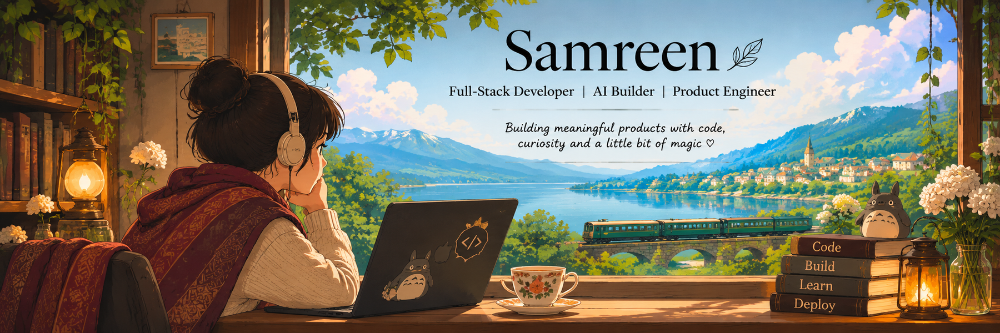
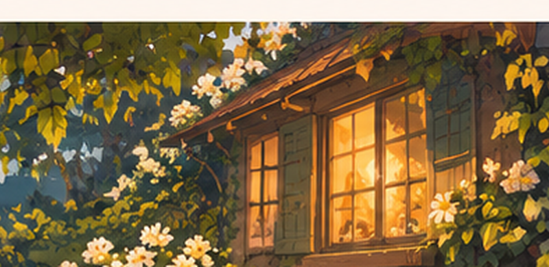

  

  FULL-STACK DEVELOPMENT &nbsp; · &nbsp; BACKEND ENGINEERING &nbsp; · &nbsp; APPLIED AI

## About

I'm a full-stack developer who builds complete web applications, with a focus on backend engineering, real-time systems and applied AI. I enjoy designing APIs, working with databases and turning ideas into reliable, usable products.

**Focus areas** · Full-Stack Development · Backend / API Design · Real-Time Systems · Databases · Applied AI

---

## Selected Work

<table>
  <tr>
    <td width="50%" valign="top">
      
      <h3><a href="https://github.com/samreenmj/Scrible">Scrible ↗</a></h3>
      
<strong>Real-time collaborative whiteboard</strong>

      
A collaborative whiteboard for teams to draw, plan and ideate together, using Next.js, Express, WebSockets, JWT room access and persistent canvas data with PostgreSQL and Prisma.

      Next.js · Node.js · WebSockets · PostgreSQL · Prisma
    </td>
    <td width="50%" valign="top">
      
      <h3><a href="https://github.com/samreenmj/Purplexity">Purplexity ↗</a></h3>
      
<strong>Search-grounded AI research</strong>

      
A web research assistant that combines Tavily search results with an OpenRouter-hosted model and streams cited answers to a React interface using server-sent events.

      React · TypeScript · Express · Tavily · OpenRouter · SSE
    </td>
  </tr>
  <tr>
    <td width="50%" valign="top">
      
      <h3><a href="https://github.com/samreenmj/relaygraph">RelayGraph ↗</a></h3>
      
<strong>Graph-backed agent coordination prototype</strong>

      
A graph-backed prototype for agent handoffs and persistent task memory, with PostgreSQL and FalkorDB integrations. The dashboard defaults to a mock adapter, so its displayed worker activity is demo data.

      TypeScript · Fastify · PostgreSQL · FalkorDB · Docker
    </td>
    <td width="50%" valign="top">
      
      <h3><a href="https://github.com/samreenmj/Alyzr">Alyzr ↗</a></h3>
      
<strong>Product engineering studio</strong>

      
A studio website focused on production-readiness reviews, MVP engineering and focused AI implementation for founders and builders.

      Next.js · React · TypeScript · Tailwind CSS · Nodemailer
    </td>
  </tr>
</table>

---

## Technical Toolkit

**Languages &amp; interfaces** 
 JavaScript · TypeScript · React · Next.js

**Backend &amp; data** 
 Node.js · Express · REST APIs · JWT · Docker · Docker Compose · Git · pnpm 
 WebSockets 
 PostgreSQL · Prisma

**Applied AI** 
 RAG · Embeddings · Vector Search · LLM API Integration · Tool Calling · Agent Workflows · Search-grounded Generation

## Currently Exploring

Agentic AI · RAG · DevOps · Scalable backend architecture

---

## Connect

| Portfolio | LinkedIn | Email |
|---|---|---|
| [samreen-portfolio26.vercel.app](https://samreen-portfolio26.vercel.app) | [linkedin.com/in/samreenmujtaba](https://www.linkedin.com/in/samreenmujtaba) | [samreenmj@gmail.com](mailto:samreenmj@gmail.com) |

Build with intention. Ship with care.

