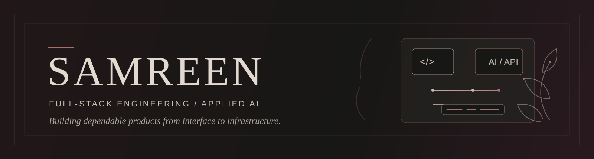

  

<h1 align="center">SAMREEN</h1>

<strong>Full-Stack Engineer&nbsp; | &nbsp;AI-enabled Product Builder</strong>

I build dependable digital products—and practical AI systems designed to earn their place in the stack.

---

### About

I work across the product surface: thoughtful interfaces, backend services, APIs, and the databases that connect them. My projects include complete web applications, real-time collaboration, and applied AI—from streaming, search-grounded answers to graph-backed agent coordination prototypes.

### Selected work

<table>
  <tbody>
    <tr>
      <td width="50%" valign="top">
        <h3><a href="https://github.com/samreenmj/Scrible">Scrible</a></h3>
        
A shared whiteboard for drawing together in real time.

        
Next.js client with separate Express and WebSocket services; JWT room access and persistent canvas data backed by PostgreSQL and Prisma.

        Next.js · TypeScript · Express · WebSockets · PostgreSQL · Prisma · pnpm
      </td>
      <td width="50%" valign="top">
        <h3><a href="https://github.com/samreenmj/Purplexity">Purplexity</a></h3>
        
A web research assistant that turns search results into cited answers.

        
React interface receives Tavily search sources and streams answers from an OpenRouter-hosted language model over server-sent events.

        React · TypeScript · Express · Tavily · OpenRouter · SSE
      </td>
    </tr>
    <tr>
      <td width="50%" valign="top">
        <h3><a href="https://github.com/samreenmj/relaygraph">RelayGraph</a></h3>
        
A graph-backed prototype for agent handoffs and persistent task memory.

        
Typed dashboard and API with PostgreSQL and FalkorDB integrations. The dashboard currently defaults to a mock adapter, so its worker activity is demonstration data.

        Next.js · TypeScript · Express · PostgreSQL · FalkorDB · Docker
      </td>
      <td width="50%" valign="top">
        <h3><a href="https://github.com/samreenmj/Alyzr">Alyzr</a></h3>
        
A product engineering studio site for moving ideas toward production.

        
Next.js studio experience covering production-readiness reviews, MVP development, focused AI workflows, and ongoing engineering support.

        Next.js · React · TypeScript · Tailwind CSS · Nodemailer
      </td>
    </tr>
  </tbody>
</table>

### Technical toolkit

| Focus | Tools |
|:--|:--|
| **Product & frontend** | JavaScript · TypeScript · React · Next.js |
| **Backend & realtime** | Node.js · Express · REST APIs · WebSockets · JWT · server-sent events |
| **Data** | PostgreSQL · SQL · Prisma · FalkorDB |
| **Build & delivery** | Docker · Docker Compose · Git · pnpm |
| **Applied AI** | LLM API integration · search-grounded answers · agent-workflow prototyping |

### Currently exploring

Building dependable AI applications, better agent handoffs, thoughtful backend architecture, and the engineering practices that help prototypes become production-ready software.

### Connect

[Portfolio](https://samreen-portfolio26.vercel.app) &nbsp;·&nbsp;
[LinkedIn](https://www.linkedin.com/in/samreenmujtaba) &nbsp;·&nbsp;
[Email](mailto:samreenmj@gmail.com) &nbsp;·&nbsp;
[GitHub](https://github.com/samreenmj)
