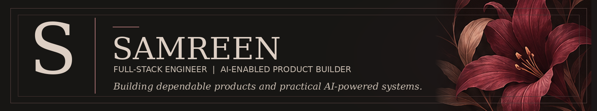
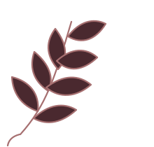
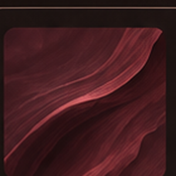
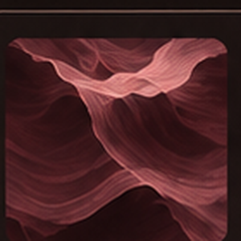

  

<table>
  <tbody>
    <tr>
      <td width="24%" valign="middle">
        
<strong>01 / ABOUT</strong>

        
      </td>
      <td width="76%" valign="middle">
        
I'm a full-stack developer who builds complete web applications, with a focus on backend engineering, real-time systems and applied AI. I enjoy designing APIs, working with databases and turning ideas into reliable, usable products.

        <table>
          <tbody>
            <tr>
              <td align="center" width="20%"> Full-Stack Development</td>
              <td align="center" width="20%"> API Design &amp; Backend</td>
              <td align="center" width="20%"> Real-Time Systems</td>
              <td align="center" width="20%"> Databases &amp; Integration</td>
              <td align="center" width="20%"> AI &amp; RAG Implementations</td>
            </tr>
          </tbody>
        </table>
      </td>
    </tr>
  </tbody>
</table>

---

<strong>02 / SELECTED WORK</strong>

<table>
  <tbody>
    <tr>
      <td width="50%" valign="top">
        
        <h3><a href="https://github.com/samreenmj/Scrible">Scrible &#8599;</a></h3>
        
<strong>Real-time collaboration</strong>

        
A collaborative whiteboard for teams to draw, plan and ideate together, using Next.js, Express, WebSockets, JWT room access and persistent canvas data with PostgreSQL and Prisma.

        Next.js &middot; Node.js &middot; WebSockets &middot; PostgreSQL &middot; Prisma
         
      </td>
      <td width="50%" valign="top">
        
        <h3><a href="https://github.com/samreenmj/Purplexity">Purplexity &#8599;</a></h3>
        
<strong>Search-grounded AI</strong>

        
A web research assistant that combines Tavily search results with an OpenRouter-hosted model and streams cited answers to a React interface using server-sent events.

        React &middot; TypeScript &middot; Express &middot; Tavily &middot; OpenRouter &middot; SSE
         
      </td>
    </tr>
    <tr>
      <td width="50%" valign="top">
        
        <h3><a href="https://github.com/samreenmj/relaygraph">RelayGraph &#8599;</a></h3>
        
<strong>Agent coordination prototype</strong>

        
A graph-backed prototype for agent handoffs and persistent task memory, with PostgreSQL and FalkorDB integrations. The dashboard defaults to a mock adapter, so its displayed worker activity is demo data.

        TypeScript &middot; Fastify &middot; PostgreSQL &middot; FalkorDB &middot; Docker
         
      </td>
      <td width="50%" valign="top">
        
        <h3><a href="https://github.com/samreenmj/Alyzr">Alyzr &#8599;</a></h3>
        
<strong>Product engineering studio</strong>

        
A studio website focused on production-readiness reviews, MVP engineering and focused AI implementation for founders and builders.

        Next.js &middot; React &middot; TypeScript &middot; Tailwind CSS &middot; Nodemailer
         
      </td>
    </tr>
  </tbody>
</table>

---

<table>
  <tbody>
    <tr>
      <td width="62%" valign="top">
        
<strong>03 / TECHNICAL TOOLKIT</strong>

        <table>
          <tbody>
            <tr>
              <td width="52%" valign="top">
                
 &nbsp; <strong>Core Development</strong>

                JavaScript &middot; TypeScript &middot; React &middot; Next.js Node.js &middot; Express &middot; REST APIs &middot; WebSockets JWT &middot; PostgreSQL &middot; Prisma &middot; Docker Docker Compose &middot; Git &middot; pnpm
              </td>
              <td width="48%" valign="top">
                
 &nbsp; <strong>Applied AI</strong>

                RAG &middot; Embeddings &middot; Vector Search LLM API Integration &middot; Tool Calling Agent Workflows &middot; Search-grounded Generation
              </td>
            </tr>
          </tbody>
        </table>
      </td>
      <td width="38%" valign="top">
        
<strong>04 / CURRENTLY EXPLORING</strong>

        
Building dependable AI applications, agentic workflows and scalable backend architecture, with a focus on turning prototypes into production-ready software.

      </td>
    </tr>
  </tbody>
</table>

---

<table>
  <tbody>
    <tr>
      <td width="24%" valign="middle"><strong>05 / CONNECT</strong></td>
      <td width="26%" valign="middle"><strong>Portfolio</strong> <a href="https://samreen-portfolio26.vercel.app">samreen-portfolio26.vercel.app</a></td>
      <td width="24%" valign="middle"><strong>LinkedIn</strong> <a href="https://www.linkedin.com/in/samreenmujtaba">linkedin.com/in/samreenmujtaba</a></td>
      <td width="26%" valign="middle"><strong>Email</strong> <a href="mailto:samreenmj@gmail.com">samreenmj@gmail.com</a></td>
    </tr>
  </tbody>
</table>

BUILD WITH INTENTION &nbsp;&middot;&nbsp; SHIP WITH CARE

